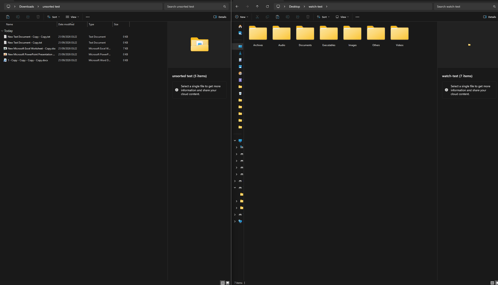

# File Organizer

An auto-running background file watcher that automatically sorts files into categorized subfolders as they arrive. By default, it is set to watch your downloads folder, but it can be changed via the config.toml file.

Built as a personal tool, with a focus on doing the boring parts
correctly: not moving partial downloads, not overwriting duplicates,
and being able to undo everything.

## Demo


## Features
- **Live watching** — files are organized the moment they finish
  downloading, not on a schedule
- **Stability detection** — waits until a file has stopped growing
  before moving it, so partial downloads don't get scrambled
- **Nested categories** — `Documents/Word/`, `Images/Photos/`, etc.
- **Duplicate handling** — second `report.docx` becomes `report_1.docx`,
  nothing is overwritten
- **Undo** — `python main.py undo` reverses the most recent batch
- **Configurable** — categories and paths live in `src/file_organizer/config.toml`
- **Logged** — every move recorded to `~/organizer.log`
- **Threaded sweep** — bulk organizing uses a small thread pool

## Requirements

- Python 3.11+ (uses `tomllib` and `X | Y` type hints)
- `watchdog`

## Install
```bash
git clone https://github.com/bryantsetyobudi634-wq/file-organizer.git
cd file-organizer
python -m venv .venv
source .venv/bin/activate   # Windows: .venv\Scripts\activate
pip install -r requirements.txt
```

## Usage
```bash
python main.py watch       # start watching the folder (default)
python main.py organize    # sweep once and exit
python main.py undo        # reverse the most recent batch
python main.py history     # show recent batches
```
Run with no arguments to start watching:

```bash
python main.py
```

## Configuration

Edit `src/file_organizer/config.toml` to change the watched folder, the destination,
and the category structure:

```toml
[paths]
watch = ""            # empty = ~/Downloads
destination = ""      # empty = same as watch

[categories.Documents]
Word = [".docx", ".doc"]
PDF  = [".pdf"]

[categories.Images]
Photos = [".jpg", ".png"]
```

Any file whose extension isn't in any category is left alone and
logged.

## How it works
**Using the `watchdog` functionality to live watch:**  A `FileSystemEventHandler`
listens for `created` and `moved` events in the watch folder. When
a new file appears, it's organized immediately.

**Stability detection:** As described above, the intention of this tool is to auto-organize files within the downloads folder. A `wait_until_stable` function is created to ensure that files currently being downloaded from any source are not to be moved before the download is finished. It does so by seeing if `os.path.getsize(filepath)` changes. If it does not within 2 seconds, it is then deemed as complete and is then moved to the designated category.

**Nested categories.** A dict-of-dicts maps category → subcategory
→ extensions. `find_destination()` does the lookup; the rest of
the code doesn't care about the structure.

**Atomic moves.** `os.rename` is used when source and destination
are on the same filesystem — it's a directory entry update, not a
copy. `shutil.move` is the fallback for cross-filesystem moves.

**Undo via SQLite.** Every successful move is recorded in
`~/.file_organizer/history.db` with a batch ID. `undo` reverses
the most recent batch, newest-first, and deletes the batch on
full success.

## Testing

Tests are run with [pytest](https://pytest.org): pytest

Writing the first tests for `find_destination` surfaced a
case-sensitivity bug: `REPORT.DOCX` fell through to no
category because `str.endswith` is case-sensitive. Filenames
are now lowercased before matching, and the test suite covers
that case.

## Known limitations
- **Stability detection is heuristic.** If the connection is too weak or too unstable, it may mess up the stability detection function and accidentally move a downloading file before it finishes.
- **One batch per process run.** `undo` reverses everything since the watcher was last started. Fine-grained undo (per hour, per folder) would need a different batch model.
- **No file-lock check.** On Windows, a file open in another program can't be moved; this is logged and skipped.

## License
MIT 